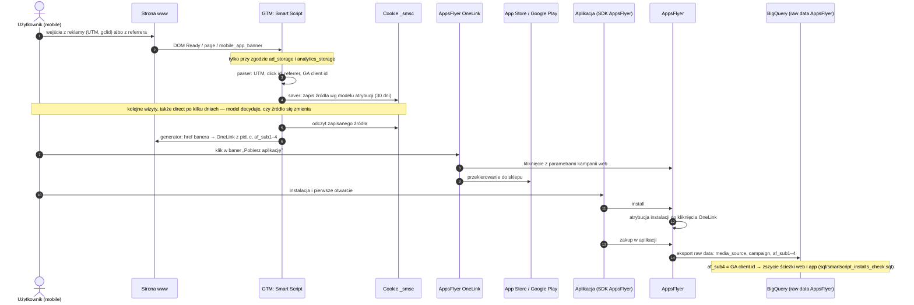

# Diagram sekwencji UML: źródło z www → instalacja w aplikacji

Jak źródło ruchu ze strony trafia do atrybucji instalacji i zakupu w aplikacji. Opis mechanizmu i konfiguracji: [README](README.md).

| Krok | Kto | Po co |
|---|---|---|
| 1–4 | tag GTM | źródło zapisane w pierwszej wizycie przetrwa powrót direct |
| 5–6 | tag GTM | link do sklepu niesie kampanię, której nie widzi SDK aplikacji |
| 7–13 | AppsFlyer | instalacja i zakup trafiają do kampanii web zamiast „organic” |
| 14 | data engineer / analityk | kontrola instalacji z `af_channel = af_web_smartscript` w BigQuery |
